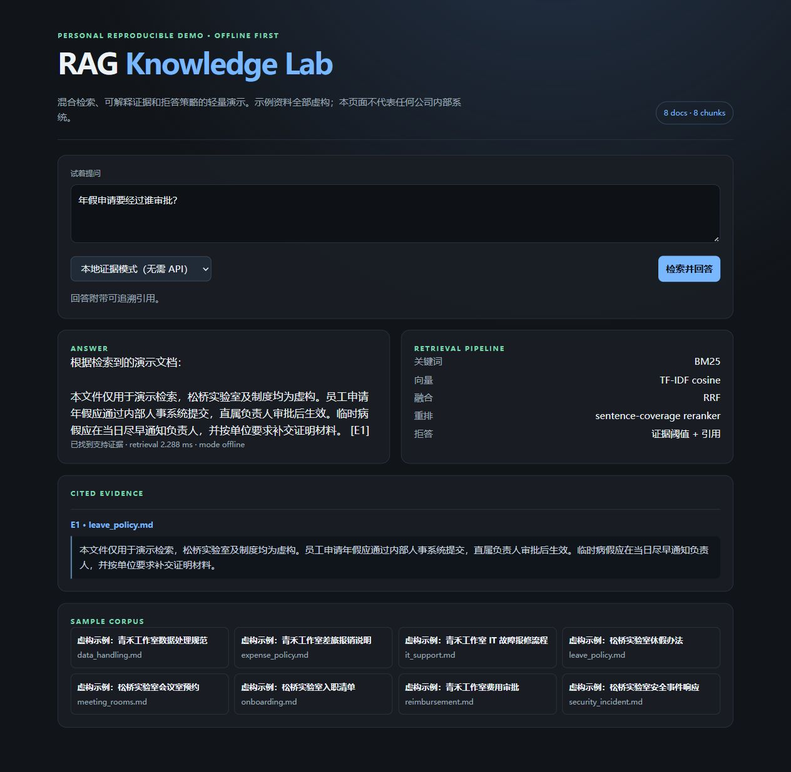
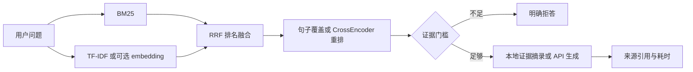

# RAG Knowledge Lab

[](https://github.com/shiyaotang6-dev/rag-knowledge-lab/actions/workflows/test.yml)

一个可独立运行的 RAG（检索增强生成）个人复现项目：从一组虚构的内部知识库文档出发，用混合检索找到证据，展示来源引用，并在证据不足时拒绝编造答案。项目用于展示工程思路与可复现实验，**不是任何公司的内部代码、生产系统或原实习项目源码**。



## 能看到什么

- BM25 关键词检索 + TF-IDF cosine 向量检索，以 Reciprocal Rank Fusion（RRF）融合排名。
- 透明的句子覆盖重排基线；可选 `sentence-transformers` embedding 与 CrossEncoder reranker。
- 离线证据模式：直接基于证据片段回答，零 API key、零模型下载即可运行。
- 可选 OpenAI-compatible API：API 地址、key、model 全由环境变量提供，模型 ID 不写死。
- 引用 `[E1]` 和证据面板；证据阈值不够时显式拒答。
- FastAPI JSON API、静态演示页、CLI 评测与 pytest 测试。

## 运行

```powershell
# Python 3.10+，在仓库根目录执行
python -m venv .venv
.venv\Scripts\Activate.ps1
python -m pip install -e ".[test]"

# 离线问答与评测
python -m rag_lab.cli ask "发现账号被盗后应该怎么办？"
python -m rag_lab.cli eval --output reports/eval.json
python -m pytest -q

# 启动浏览器演示页
python -m uvicorn rag_lab.api:app --reload
# 打开 http://127.0.0.1:8000
```

也可以用 `pip install -e .` 后运行 `rag-lab ask ...`。首次运行只使用 scikit-learn 与 rank-bm25，不联网下载模型。

## 可选模型调用

复制 `.env.example`，填写真正可用的 OpenAI-compatible 服务信息：

```powershell
$env:RAG_API_KEY = "your-key"
$env:RAG_API_BASE = "https://api.deepseek.com"
$env:RAG_MODEL = "provider-model-id"
python -m uvicorn rag_lab.api:app
```

`RAG_MODEL` 必须是服务商账户中实际可用的 ID。模型输出必须包含检索证据中的 `[E1]` 等引用；没有引用的回答会被拒绝。不要把 `.env` 或 API key 提交到仓库。

## 评测口径

`eval` 使用仓库内的 8 条可回答与 2 条不可回答合成问题，报告 Hit@K、MRR、拒答准确率和检索耗时。耗时只覆盖已建索引后的本地 retrieval，**不包含索引构建、模型下载、远程 API 请求或答案生成**。评测指标是本机运行结果，不代表线上吞吐或生产质量。

一次实际执行的完整结果与依赖版本保存在 [example_eval.json](docs/example_eval.json)。这 10 条问题是小型软件测试夹具，不能用于证明未见问题上的泛化能力；神经模型和远程生成没有在本示例结果中启用。

## 检索与证据流程



默认 TF-IDF 是词法向量基线；默认重排器是可解释的句子覆盖打分，**不是神经网络 reranker**。拒答检查结合词法相关度、句子覆盖率与去除示例组织名后的实质词匹配；它能覆盖当前夹具中的典型无依据问题，但不构成可靠的生产事实核验。

## 目录

```text
src/rag_lab/
  core.py          混合检索、融合、重排、证据和 API 生成
  api.py           FastAPI 接口
  cli.py           ask / index / eval 命令
  data/docs/       8 份虚构、公开安全的中文资料
  static/          无外部依赖的演示页
tests/             检索、拒答、评测与 API 配置测试
```

## 限制与下一步

样例语料很小，TF-IDF 并不等于语义 embedding；实际项目应在目标领域语料上做切分、召回和阈值评估，并增加人工标注集。需要更强的模型时，可设置 `RAG_EMBEDDING_MODEL` 和 `RAG_RERANKER_MODEL`（安装 `pip install -e ".[neural]"`），但下载模型会改变运行时间和资源需求。生产系统还需要鉴权、审计、文档更新流水线、敏感信息检测、限流和监控。

API 模式只校验证据引用是否存在于检索结果，不能自动证明每个生成语句都由证据支持；此处未对真实服务做性能或幻觉率评估。`.env.example` 是配置说明，本项目不会自动加载 `.env`，应按上面的命令设置环境变量。

## 许可

MIT。示例文档为虚构内容，仅供学习与演示。
